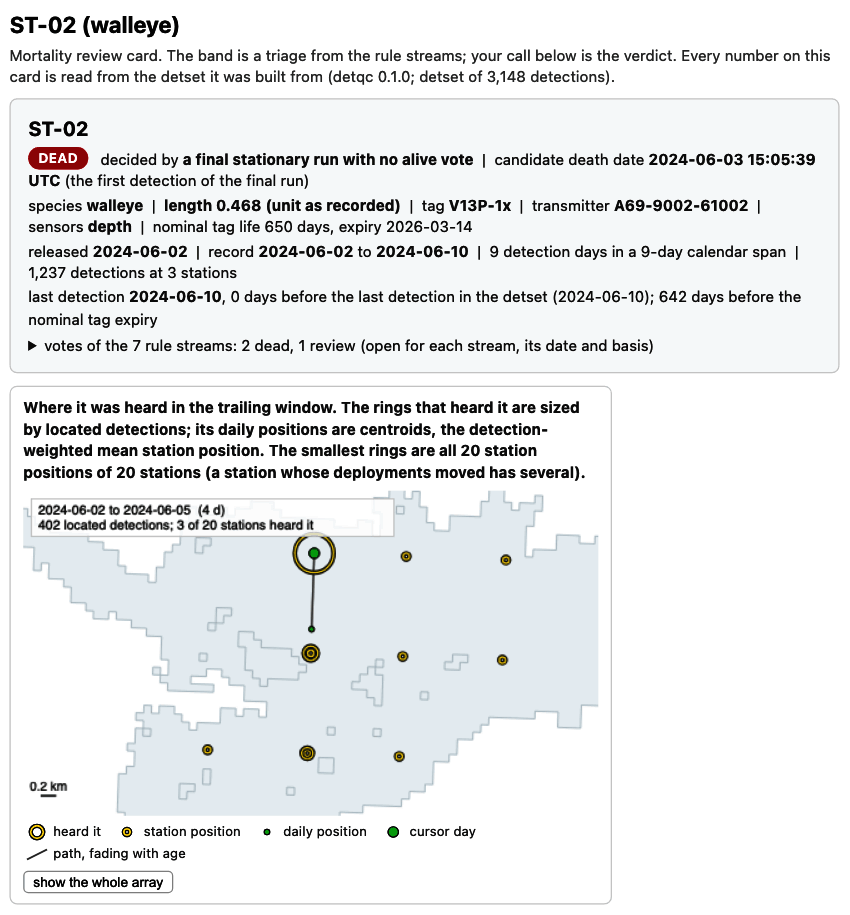
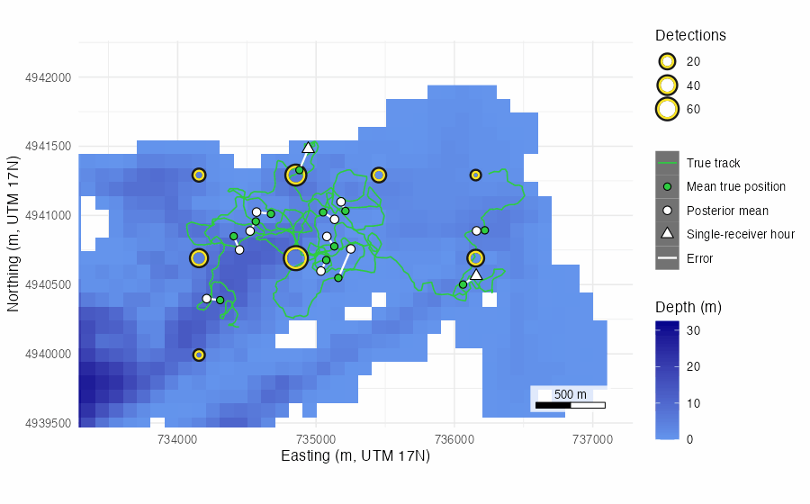
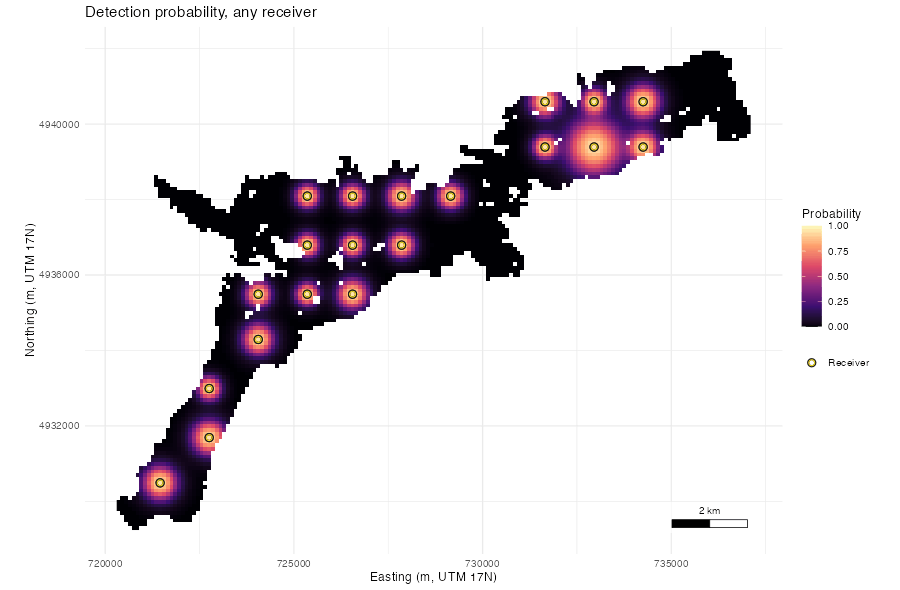
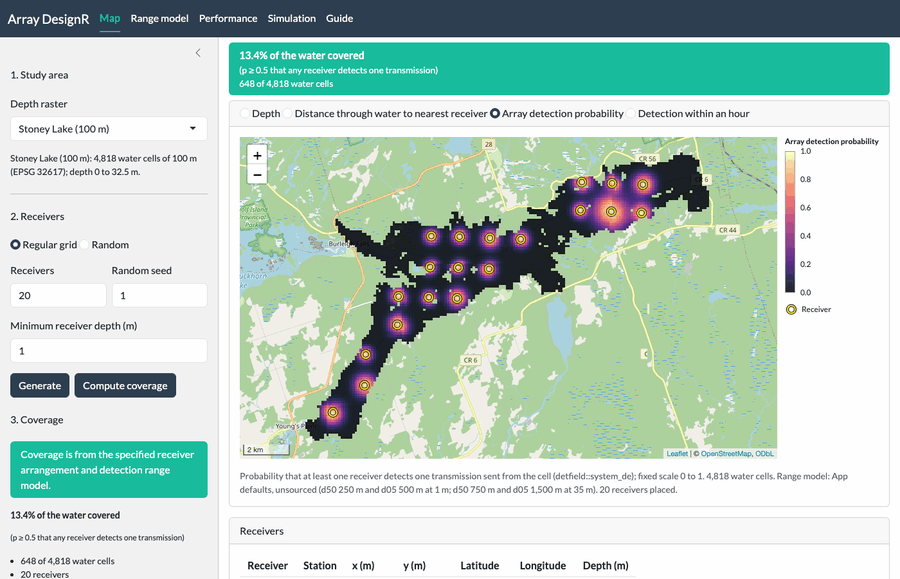

<!-- README.md is knitted from README.Rmd; edit README.Rmd. -->

# positionR 

[-blue.svg)](https://www.gnu.org/licenses/gpl-3.0)

positionR is a suite of four R packages for studies that track aquatic
animals with fixed acoustic receivers. A detection set cleaned in detqc
is the input of detfield, which positions the animals. A detection-range
model from detfield is the input of the simulations of arraydesign, and
the arraydesignR app runs arraydesign. The packages share one set of
column names and one example, Stoney Lake, Ontario. The **positionR**
package installs all four and does not attach them; each can also be
installed on its own.

detqc reads detections from OTN, GLATOS and InnovaSea exports, receiver
deployments from OTN and GLATOS exports, and animals from OTN tagging
records and GLATOS workbooks and exports.

detfield and arraydesign take a depth raster in a projected CRS in
metres, such as the UTM zone of the lake. The scale of that CRS at the
raster centre must be within 1 percent of 1. Both packages refuse any
other CRS, including one whose scale at the raster centre cannot be
measured. The arraydesignR app also takes a raster in longitude and
latitude, with longitudes from -180 to 180 or from 0 to 360. That raster
may span at most 12 degrees of longitude and 12 degrees of latitude. The
app projects it to the six-degree UTM zone of its centre.

## Install

``` r
# install.packages("remotes")
remotes::install_github("jakebrownscombe/positionR")
```

One package on its own:

``` r
remotes::install_github("jakebrownscombe/detqc")
remotes::install_github("jakebrownscombe/detfield")
remotes::install_github("jakebrownscombe/arraydesign")
remotes::install_github("jakebrownscombe/arraydesignR")
```

`positionR_packages()` lists the four with the versions installed:

``` r
positionR::positionR_packages()
#> positionR: 4 packages, 4 installed
#> 
#> detqc 0.1.1
#>   read, check and filter detections
#>   https://jakebrownscombe.github.io/detqc/
#> 
#> detfield 0.1.1
#>   detection fields and positions
#>   https://jakebrownscombe.github.io/detfield/
#> 
#> arraydesign 0.1.1
#>   design and test the performance of tracking systems
#>   https://jakebrownscombe.github.io/arraydesign/
#> 
#> arraydesignR 0.1.0
#>   arraydesign as a point-and-click application
#>   https://jakebrownscombe.github.io/arraydesignR/
```

## The suite


*The functions of each package in the order of a study, from your files
to the tools the results go to.*

- [**detqc**](https://jakebrownscombe.github.io/detqc/): read, check and
  filter detections.

  

  *The top of the review card of walleye ST-02 in the simulated Stoney
  Lake study, which the rules put in the dead band.*

  [Get started with
  **detqc**](https://jakebrownscombe.github.io/detqc/articles/detqc.html).

- [**detfield**](https://jakebrownscombe.github.io/detfield/): detection
  fields and positions.

  

  *Hourly positions of simulated animal stoney-01 from 16:00 UTC on 1
  June to 04:00 UTC on 2 June 2024. Each hour's posterior mean is joined
  by its error to the animal's mean true position in that hour, and the
  true track has one position a minute. The hours heard by two receivers
  or more fall a median 93 m from the truth; the two single-receiver
  hours fall 114 and 165 m from it. Each receiver's detections are
  counted over these 12 hours. All 8 receivers in view heard the animal;
  the study has 70.*

  Get started: [Fish positioning with detection range
  information](https://jakebrownscombe.github.io/detfield/articles/detfield.html).

- [**arraydesign**](https://jakebrownscombe.github.io/arraydesign/):
  design and test the performance of tracking systems.

  

  *Probability that one transmission from each 100 m water cell of
  Stoney Lake is heard by at least one of 20 receivers. The receivers
  sit on a grid over water at least 1 m deep. The range model is a
  stand-in curve whose 50% distance is 250 m at a receiver 1 m deep and
  750 m at one 35 m deep. In 648 of the 4,818 water cells that
  probability is 0.5 or more.*

  Get started: [Design and test an array for Stoney
  Lake](https://jakebrownscombe.github.io/arraydesign/articles/arraydesign.html).

- [**arraydesignR**](https://jakebrownscombe.github.io/arraydesignR/):
  **arraydesign** as a point-and-click application.

  

  *The Map tab of the application on the bundled Stoney Lake raster, at
  its default settings of 20 receivers on a grid. The receivers and the
  range model are those of the arraydesign picture above, so the app
  counts the same 648 water cells at 0.5 or more.*

  Get started: [The app, tab by
  tab](https://jakebrownscombe.github.io/arraydesignR/articles/arraydesignR.html).

## Acoustic telemetry studies, end to end

1.  **Design and test the array.** `place_receivers()` and
    `evaluate_array()` in **arraydesign**: [Design an array for your own
    water body: compare
    layouts](https://jakebrownscombe.github.io/arraydesign/articles/design-an-array.html).
2.  **Read, check and filter the detections.** `read_detections()`,
    `check_detset()`, the `filter_` functions and `review_mortality()`
    in **detqc**: [Base processing: read, check, and filter telemetry
    data](https://jakebrownscombe.github.io/detqc/articles/reading-files.html).
3.  **Fit or bring a range model and build the field.**
    `range_test_counts()`, `de_model()`, `water_distances()` and
    `de_field()` in **detfield**: [Range models: bring your own, or
    start from two
    distances](https://jakebrownscombe.github.io/detfield/articles/range-model.html).
4.  **Position the animals.** `as_detfield_input()` in **detqc**, then
    `bin_detections()`, `location_surface()` and `credible_region()` in
    **detfield**: [Position fish from a cleaned detection
    set](https://jakebrownscombe.github.io/detfield/articles/from-detqc.html).
5.  **Export.** `write_detset()`, `to_glatos()` and
    `processing_report()` in **detqc**, and `sample_locations()` in
    **detfield**: [Export the dataset and generate a summary
    report](https://jakebrownscombe.github.io/detqc/articles/exporting.html).

Steps 2 to 4 on your own files, where `field` is the detection field of
step 3:

``` r
library(detqc)
dets <- detset(read_detections("dets.csv"), read_deployments("receivers.csv"),
  read_animals("animals.csv", tag_specs = read_tag_specs("tags.csv")))
dets <- filter_min_lag(check_detset(dets), max_lag_s = 4500)
counts <- do.call(detfield::bin_detections, as_detfield_input(dets))
surface <- detfield::location_surface(counts, field)
```

## Coming from positionR 1.x

Version 2.0.0 of **positionR** starts a new line of packages.
**positionR** 1.x was one package that positioned animals by weighted
average detection efficiency (WADE). The four packages do not yet do
everything it did. None of them estimates space use, draws absences from
a space-use region, weights receivers by information or analyses
behavioural states. The Stoney Lake walleye detections of 1.x are not
included. Keep **positionR** 1.7.0 for those jobs; the
[changelog](https://jakebrownscombe.github.io/positionR/news/index.html)
maps every 1.x function to its place in the four packages. For habitat
selection, **detfield** draws presence points from position surfaces and
availability points from the array's detection probability. It stacks
them into the table a conditional logistic regression takes, and fits no
model. Its [habitat-selection
article](https://jakebrownscombe.github.io/detfield/articles/habitat-selection.html)
shows that position draws underestimate a preference for shallow water.

``` r
remotes::install_github("jakebrownscombe/positionR@v1.7.0")
```

## Cite

Brownscombe J (2026). *positionR: tools for acoustic telemetry studies*.
R package version 2.0.0, <https://jakebrownscombe.github.io/positionR/>.

## How the code was written

The code and this documentation were written with an AI coding
assistant, Claude Code v2.1.145.

## Licence

GPL (\>= 3).
